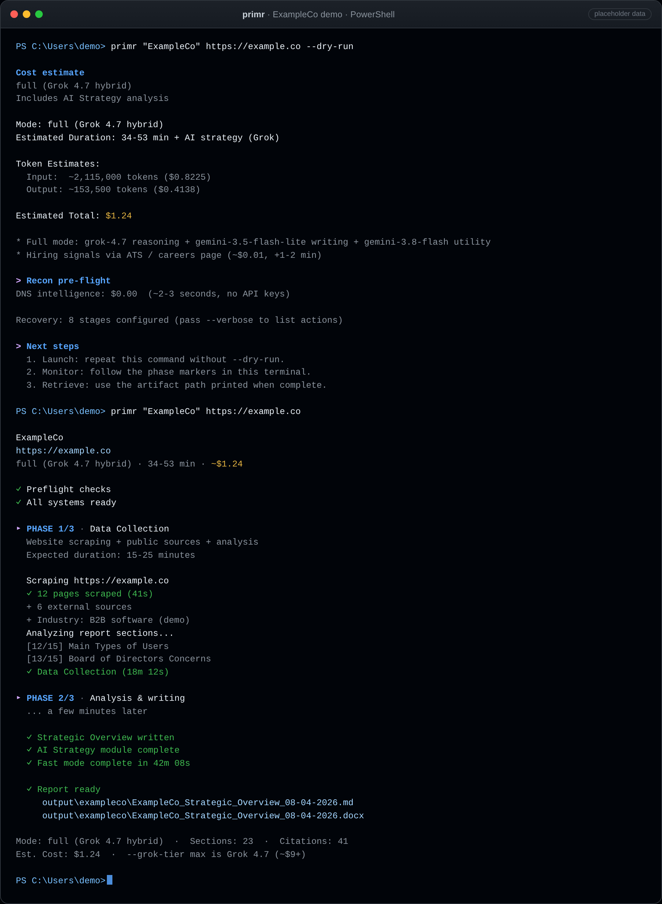

# Primr

[](https://github.com/pueo-labs/primr/actions/workflows/ci.yml)
[](https://pypi.org/project/primr/)
[](https://www.python.org/downloads/)
[](https://opensource.org/licenses/Apache-2.0)
[](https://scorecard.dev/viewer/?uri=github.com/pueo-labs/primr)

**Company name + website → researched, long-form strategic reports.**
Built for agent hosts and the CLI: structured research, strategic insight, and
durable Word and Markdown artifacts, not a free-form chat essay.

Point Primr at a company name and website and it does three things:

1. **Strategic Overview.** It researches the company in depth: scrapes the
   site, reads job postings, gathers news, recon, and industry analysis. Then
   it writes a detailed long-form Company Strategic Overview: what the company
   does, how it makes money, its market, tensions, risks, and the questions
   worth asking. That is far more than a list of facts.
2. **AI Strategy.** It builds on everything learned, plus the technology the
   company appears to use (from DNS recon and current platform news), to write
   a long-form AI Strategy. It ideates on what the company may already be
   doing and on what most likely makes sense for it next.
3. **Skill pack (optional).** It ideates on the company's key roles and drafts
   AI agent skills for them.

Facts are cited where sources exist. Strategy and ideas are informed reasoning,
because companies rarely publish their strategy.

Run it two ways. In a terminal, the CLI does the work with provider APIs after
an estimate and your approval. In an agent (Claude Code, Claude Cowork, Copilot
Cowork, Codex, and others), the agent uses Primr as a tool through its skill or
MCP server, and by default runs **Primr Zero**: the same agentic research and
writing process, aiming for the best output it can, using the agent you already
have instead of paid API calls.

Point an agent at the repo, or run the CLI. Both paths use the same
evidence, uncertainty, and long-form artifact contract, but their execution,
model ownership, and assurance are different.

<p align="center">
  
</p>

<p align="center"><sub>Placeholder demo data (ExampleCo), not a live company capture.</sub></p>

```bash
primr "ExampleCo" https://example.co
```

In an agent chat, that request **defaults to Primr Zero**: keyless evidence
collection in Primr, research and writing in the host (when the host plan does
not bill API usage). When a human runs the command **directly in a terminal**,
it retains the **provider-backed** CLI path after a dry-run estimate and
approval.

## What it is for

Use Primr when you need a serious first draft for discovery, account planning,
diligence, competitive analysis, or strategy work, not a two-paragraph pre-call
blurb (use normal web search for that).

- Structured brief with uncertainty labels, not scattered notes
- Research grounded in public evidence, not only search summaries
- Cost-aware local execution: dry-run before billable work
- Reusable Markdown/DOCX artifacts for humans, agents, and downstream tools

Primr is not a generic crawler, a SaaS collaboration app, a model-serving
platform, or a tool for bypassing authentication, paywalls, or site restrictions.

## Start here

| Where you run it | Default path | Spend | Result |
|---|---|---|---|
| Agent chat pointed at Primr | Primr Zero | No Primr model API spend; verify host plan allowance | Evidence bundle + host-written sourced dossier |
| Terminal or script | Provider-backed | Billable after a fresh quote and explicit approval | Primr Strategic Overview + strategy artifacts |
| Explicit `primr draft --local BUNDLE` | Installed model at your configured runtime | $0 model API spend when that runtime executes without billing | Cited, unvalidated draft Markdown + DOCX from captured prep evidence |

Both paths can deliver a Strategic Overview and AI Strategy as Markdown and
DOCX (on the Zero path, `primr render <file>.md` converts host Markdown to DOCX
at `$0`). The provider-backed path additionally owns its measured synthesis,
cross-validation, usage accounting, and recovery stages. A configured API key
is capability, not consent to spend.

Primr prefers a validated zero-incremental-cost route when the current agent
host or local environment can support the full artifact contract honestly.
When provider APIs are required, the Standard recipe targets the best complete
report and default strategy artifacts it can produce for approximately `$1`;
the exact dry-run estimate remains authoritative and execution still requires
explicit approval.

### Agent path

Point a capable agent at this repository:

```text
primr "ExampleCo" https://example.co
```

The agent uses Primr Zero unless you explicitly request paid, metered,
provider-backed, or premium execution. Its `primr prep` collection is already
noninteractive and needs no approval flag. Routing, confirmation rules, MCP
setup, and host handoff live in [Agent Integration](docs/AGENT_INTEGRATION.md)
and [Zero-Cost / Primr Zero](docs/ZERO_COST.md).

For a smaller draft using an installed local model, run
`primr draft --local BUNDLE --dry-run`, then remove `--dry-run` to execute.
This also supports an explicitly configured private-network inference box.
The draft records evidence coverage, model, quantization, runtime, and zero
model API spend. It does not run Primr's external research or validation stages;
review each claim against its displayed source excerpt. See
[local draft setup and limits](docs/ZERO_COST.md#draft-with-an-installed-local-model).

### Terminal path

```bash
primr "ExampleCo" https://example.co --dry-run --budget 10
primr "ExampleCo" https://example.co                  # foreground, then approve
primr "ExampleCo" https://example.co --skip-confirm   # automation, after approval
```

`--skip-confirm` is the approval signal for a noninteractive or background
launch of the standard provider-backed commands. Use it only after a person has
reviewed and approved the fresh quote. The experimental `primr orchestrate`
command is the exception: its noninteractive approval and spend ceiling is
`--max-cost <usd>` after the exact dry run is approved.

Mode matrix, platforms, strategy types, and cost controls:
[Run Modes and Costs](docs/RUN_MODES.md).

## Install

- Python 3.11 through 3.15; Python 3.15 is the default
- No API key or GPU for `primr recon` / `primr prep`
- Keys only for provider-backed research (preferred default: [OpenRouter gateway](docs/OPENROUTER.md) when configured, or direct xAI + Gemini including Google Gemini 3.8 Flash; optional direct OpenAI, Anthropic, Bedrock, Azure)
- `primr init` installs browser deps for scrape tiers

```bash
uv tool install --python 3.15 primr
primr --version
```

With pipx, use `pipx install --python python3.15 primr` and an installed Python
3.15. Plain `pip install primr` also works inside a Python 3.11 through 3.15
virtual environment. Download and inspect convenience installers
before running them. For those scripts, upgrades, PATH troubleshooting, and
source-checkout setup, see
[Installation and Upgrades](docs/INSTALLATION.md).

Provider-backed setup only when you want billable runs:

```bash
primr init
primr doctor
```

Keys and full config: [API Key Setup](docs/API_KEYS.md) |
[OpenRouter Gateway](docs/OPENROUTER.md) | [Configuration](docs/CONFIG.md).

## Common commands

| Need | Command |
|------|---------|
| Agent-host dossier (Zero by default) | `primr "Company" https://company.com` |
| Keyless evidence bundle | `primr prep "Company" https://company.com` |
| Estimate a paid run with a ceiling | `primr "Company" https://company.com --dry-run --budget 10` |
| Strategic Overview only | `primr "Company" https://company.com --no-ai-strategy` |
| Site corpus only | `primr "Company" https://company.com --mode scrape` |
| DNS only (no keys) | `primr recon company.com` |
| Skills pack | `primr skills "Company" https://company.com` |
| Markdown → DOCX/TXT ($0) | `primr render "output/report.md"` |
| Strategy on existing report | `primr --ai-strategy-only "output/report.md" --dry-run` |
| Check or install an update | `primr update --check` / `primr update` |

Focused help: `primr --help`. Everything: `primr --help-all`.

## Cost gate

Billable runs need a fresh `--dry-run` estimate and explicit approval. A
`--budget 10` cap sets a $10 ceiling for that Primr run, not a $10 target or
permission to launch. The preview reports whether the estimate fits, and an
oversized plan is not launch-ready. Unattended execution stays fail closed
unless it carries the command-specific approval signal. See
[Run Modes and Costs](docs/RUN_MODES.md#cost-controls) for the complete policy.

## Outputs

Default: customer-facing files under `output/`, diagnostics under `working/`.

- `<Company>_Strategic_Overview_<date>.md` / `.docx`
- `<Company>_AI_Strategy_<date>.md` / `.docx` (unless `--no-ai-strategy`)
- `run_manifest.json` (estimate, approval, audit)

Agent inventory (paths/roles only, no report body):
`primr://output/artifacts/by_job/{job_id}`. Full artifact and recovery guides:
[Artifacts](docs/ARTIFACTS.md) · [Recovery](docs/RECOVERY.md).

## Docs

| Topic | Guide |
|-------|-------|
| Product and delivery contract | [COMPANY_ANALYST_PRODUCT_CONTRACT](docs/design/company-analyst-product-contract.md) |
| Installation and upgrades | [INSTALLATION](docs/INSTALLATION.md) |
| Run modes and costs | [RUN_MODES](docs/RUN_MODES.md) |
| Primr Zero / host-assisted | [ZERO_COST](docs/ZERO_COST.md) |
| Agent / MCP / A2A | [AGENT_INTEGRATION](docs/AGENT_INTEGRATION.md) · [API](docs/API.md) |
| API keys | [API_KEYS](docs/API_KEYS.md) |
| Optional OpenRouter gateway | [OPENROUTER](docs/OPENROUTER.md) |
| Configuration | [CONFIG](docs/CONFIG.md) |
| Artifacts | [ARTIFACTS](docs/ARTIFACTS.md) |
| Skill packs | [SKILL_PACK](docs/SKILL_PACK.md) |
| Security | [SECURITY](docs/SECURITY.md) |
| Contributing / architecture | [CONTRIBUTING](docs/CONTRIBUTING.md) · [ARCHITECTURE](docs/ARCHITECTURE.md) |
| Direction and next changes | [NEXT_STEPS](docs/NEXT_STEPS.md) · [ROADMAP](ROADMAP.md) |
| Release history | [CHANGELOG](docs/CHANGELOG.md) · [GitHub releases](https://github.com/pueo-labs/primr/releases) |

Docs site index: [docs/README.md](docs/README.md).

## Disclaimer

Primr retrieves and analyzes public web content. You are responsible for site
terms, provider costs, output accuracy, and legal fit. AI-generated analysis can
be wrong or outdated. Verify important findings before acting on them.

## License

Apache 2.0. See [LICENSE](LICENSE).
